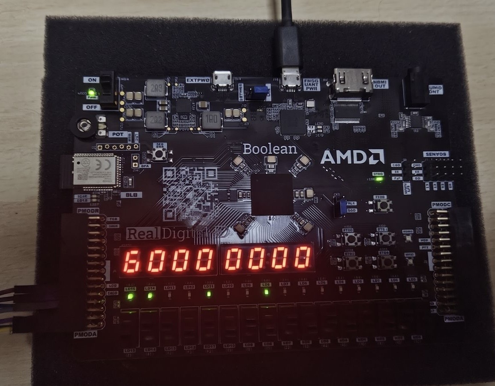
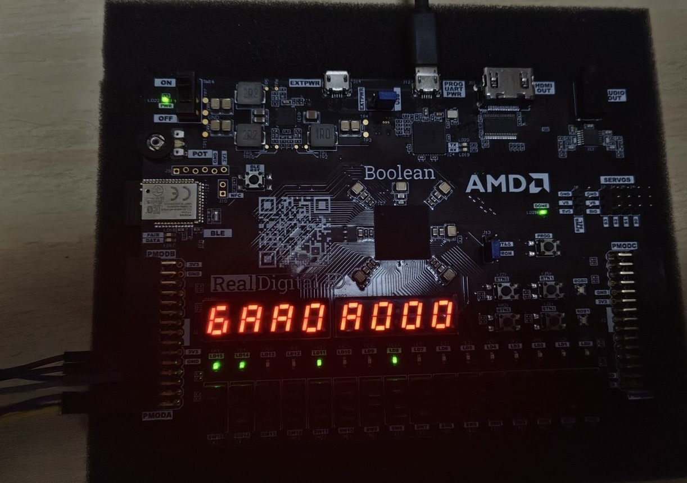
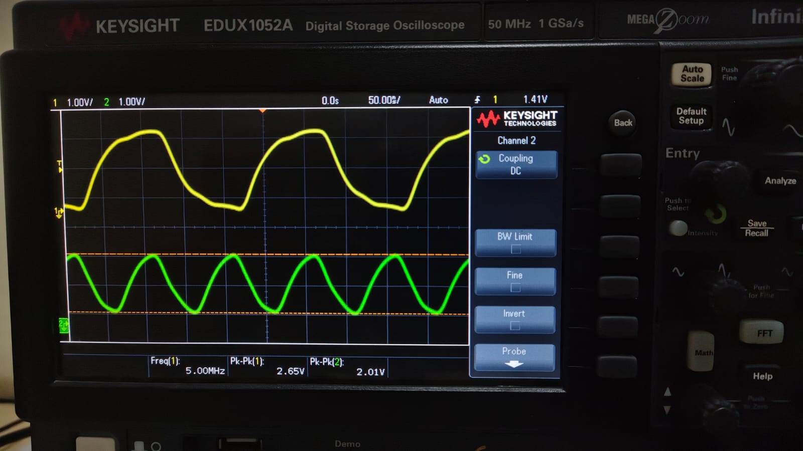
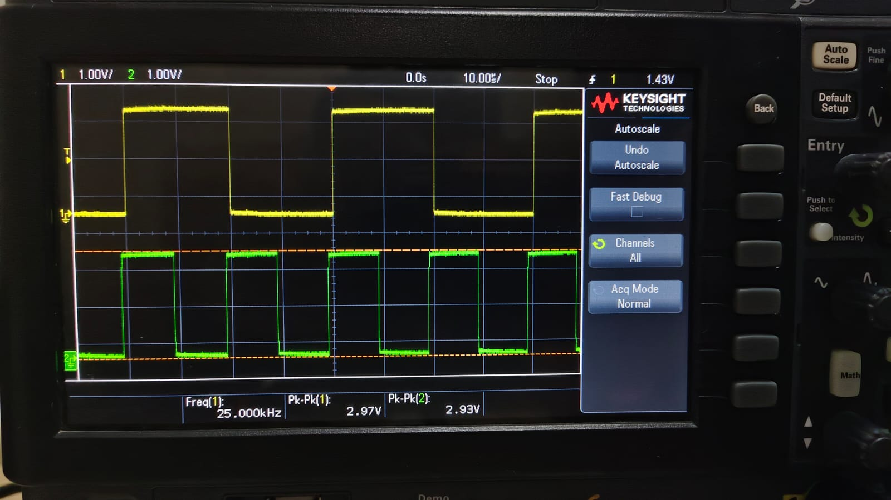
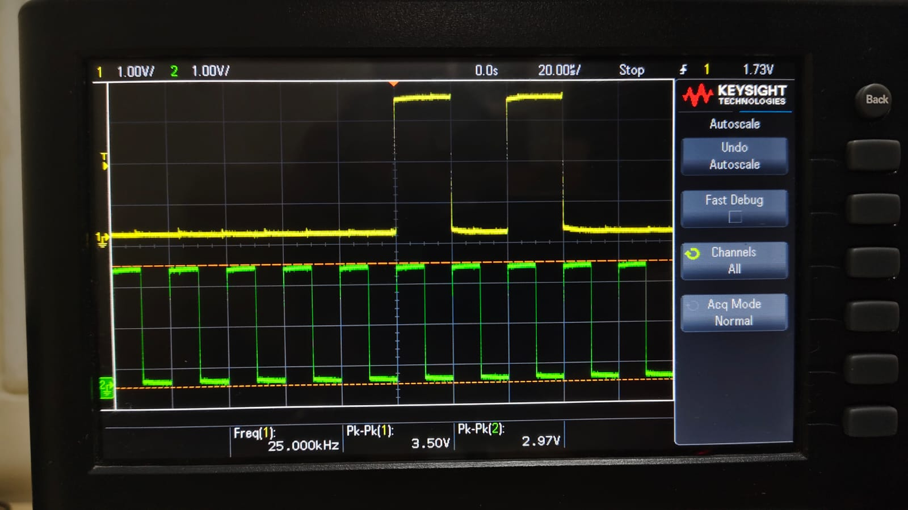

# Scalable Multi-Sensor SPI Bus Interface on FPGA

[](https://en.wikipedia.org/wiki/Verilog)
[](https://www.xilinx.com/products/design-tools/vivado.html)
[](https://platformio.org/)
[](report/spi_report.pdf)
[](LICENSE)

An end-to-end FPGA-based scalable Serial Peripheral Interface (SPI) architecture designed to solve the wire-scaling bottleneck in multi-sensor embedded systems. By replacing traditional $4N$-wire individual SPI links with a single shared 3-wire serial bus, custom addressing, and on-chip ROM width lookup, this system efficiently manages sensors with heterogeneous bit widths, atomic shadow snapshots, and hardware status multiplexing.

---

## 📌 Project Highlights

- **Shared 3-Wire Serial Bus**: Communicates with up to 28 heterogeneous sensors using just 3 lines (`DATA_IN`/`MOSI`, `DATA_OUT`/`MISO`, `CLK`) plus an active-low `CS_N`.
- **Variable Data-Width ROM Lookup**: Instead of fixed 8/16-bit boundaries, an on-chip ROM stores sensor-specific input/output bit widths and register start offsets, eliminating wasted transfer cycles.
- **Atomic Shadow Register Snapshots**: On every `READ` command (`2'b00`), live sensor inputs are latched into shadow registers within a single clock cycle, preventing data tearing and mid-read race conditions.
- **Hardware WHO_AM_I & Soft Reset**: Dedicated command modes for hardware self-identification (opcode `2'b11`) and passcode-protected soft reset (opcode `2'b10`, passcode `4'b1010` / `4'b1111`).
- **Clock Domain Crossing (CDC)**: Dual-clock domain architecture utilizing an Asynchronous Gray-Code FIFO to safely cross data between asynchronous bus and system clocks without metastability.
- **Dual 4-Digit 7-Segment FPGA Driver**: Time-multiplexed display on FPGA hardware showing live `read_reg` and `write_reg` values in hexadecimal.
- **Physical ESP32 & Oscilloscope Verification**: Validated in real hardware using an ESP32 master at both **50 kHz** and **10 MHz** clock frequencies, alongside an interactive browser-based logic analyzer dashboard.

---

## 🏛️ System Architecture

```
                       +---------------------------------------+
                       |           SPI Master (ESP32)          |
                       +---------------------------------------+
                                |             |           |
                              MOSI           MISO        SCLK
                                |             |           |
+===============================V=============V===========V===============================+
| FPGA SPI SLAVE CONTROLLER                                                               |
|                                                                                         |
|   +-------------------+      +----------------------+      +------------------------+   |
|   |   DETECT & FSM    |----->|  Memory / ROM Map    |----->|    Register File       |   |
|   |  State Controller |      | (Address & Widths)   |      |  - Live Registers      |   |
|   +-------------------+      +----------------------+      |  - Shadow Snapshot Reg |   |
|             |                                              +------------------------+   |
|             v                                                           |               |
|   +-------------------+                                                 v               |
|   | Shift Register    |                                    +------------------------+   |
|   | Serial <-> Par.   |                                    | 7-Segment FPGA Driver  |   |
|   +-------------------+                                    | Time-Multiplexed Hex   |   |
|             |                                              +------------------------+   |
|             v                                                           |               |
|   +-------------------+                                                 v               |
|   | CDC Async FIFO    |====================================> 8x 7-Segment Displays      |
|   | (Gray Code Sync)  |                                      [ READ_REG | WRITE_REG ]   |
|   +-------------------+                                                                 |
+=========================================================================================+
```

---

## 📡 Protocol Specification

Every SPI transaction begins on the falling edge of `CS_N` with a 2-bit **Operation Mode**, followed by an **Address**, and a variable-length **Data Phase**:

```
| Clocks 1 - 2 | Clocks 3 - 6 (or 3-10) | Remaining Clocks (Sensor Width) |
|:------------:|:----------------------:|:-------------------------------:|
|     MODE     |        ADDRESS         |         DATA (Burst)            |
|   (2 bits)   |      (4 or 8 bits)     |   Read on MISO / Write on MOSI  |
```

### Operation Modes
| Opcode (`MODE`) | Transaction | Description |
|:---:|:---|:---|
| `2'b00` | **READ** | Latches sensor outputs into shadow registers and streams data out on `MISO`. |
| `2'b01` | **WRITE** | Shifts serial payload from `MOSI` into the target register slice. |
| `2'b10` | **RESET** | Validates safety passcode to reset all internal registers to default states. |
| `2'b11` | **WHO_AM_I** | Transmits 8-bit hardware sensor identifier on `MISO`. |

---

## 🔬 Hardware Verification & The `A000` Phenomenon

During physical testing, an interesting hardware phenomenon occurred: streaming a simple alternating bit pattern (`0101010101...`) to the SPI slave caused the 16-bit display register to mutate from `0x0000` to `0xA000`.

### Exact Bit-Level Dissection
```
Stream:   0   1   0   1   0   1   0   1   0   1 ...
Clocks:   1   2   3   4   5   6   7   8   9  10
Field:  [  MODE ] [     ADDR     ] [    DATA    ]
Value:   0   1     0   1   0   1     0   1   0   1
          ===       ===========       ===========
         WRITE        Addr = 5        Data = 0xA (Bits 15:12)
```

1. **Clocks 1–2 (Opcode `01`)**: Interpreted by `DETECT` as `WRITE`.
2. **Clocks 3–6 (Address `0101`)**: Decodes to Sensor Address `4'd5`.
3. **ROM Lookup**: Address `5` maps to `in_width = 4`, `in_start = 12` (bits 12–15).
4. **Clocks 7–10 (Data `1010` = `0xA`)**: Written into `write_reg[15:12]`.
5. **Result**: `write_reg` updates from `16'h0000` to **`16'hA000`**, visibly confirmed on the physical 7-segment display!

| Initial State: `0x0000` | Final State: `0xA000` |
|:---:|:---:|
|  |  |

---

## 📂 Repository Structure

```
SPI_project/
├── README.md                      # Primary project documentation (this file)
├── LICENSE                        # Project license
├── .gitignore                     # Git ignore rules for EDA, Vivado, and C++
│
├── SPI/                           # RTL Architecture Evolution & Simulations
│   ├── README.md                  # Evolution guide (v1 -> v4)
│   ├── QUICK_REFERENCE.md         # Protocol & memory map reference sheet
│   ├── SPI_Bus_Project_Plan.html  # Interactive project plan & milestones
│   ├── SPI_Protocol_Overview.pptx # Architectural overview presentation
│   └── 32-reg-system/             # Multi-version Verilog RTL & Testbenches
│       ├── v1.v - v4.v            # Progressive RTL implementations
│       ├── tb_v1.v - tb_v4.v      # Self-checking testbenches
│       └── cdc-integration/       # Clock Domain Crossing (Async FIFO + Top)
│           ├── async_fifo.v       # Dual-clock Gray-code FIFO
│           ├── system_top.v       # Top-level CDC integration
│           └── v4.v               # Core controller module
│
├── SPI_BIT/                       # FPGA Hardware Projects (Xilinx Vivado)
│   ├── README.md                  # Synthesis, constraints, & pinout guide
│   ├── bitstreams/                # Ready-to-program FPGA bitstreams (.bit)
│   │   ├── fpga_wrapper.bit       # SPI_BIT bitstream (dynamic length write)
│   │   └── fpga_top.bit           # SPI_ROM bitstream (ROM-based sensor map)
│   ├── SPI_BIT/                   # Vivado project for dynamic write length
│   ├── SPI_ROM/                   # Vivado project for ROM lookup architecture
│   ├── SPI_BIT_Report_Data/       # Standalone RTL + XDC constraints for SPI_BIT
│   └── SPI_ROM_Report_Data/       # Standalone RTL + XDC constraints for SPI_ROM
│
└── report/                        # Publications, Firmware & Experimental Data
    ├── README.md                  # Documentation index
    ├── spi_report.pdf             # Comprehensive IEEE Conference Paper (PDF)
    ├── spi_report.tex             # LaTeX source of IEEE conference paper
    ├── images_description.md      # Detailed hardware oscilloscope test breakdown
    ├── images/                    # Physical setup photos & logic analyzer captures
    │   ├── setup.jpeg             # Hardware test bench setup
    │   ├── 10Mclk-whoami.jpeg     # WHO_AM_I transaction @ 10 MHz clock
    │   ├── 50khz_clk-whoami.jpeg  # WHO_AM_I transaction @ 50 kHz clock
    │   ├── asking_read_MOSI.png   # MOSI command line waveform
    │   ├── reciving_read_MISO.png # MISO data return line waveform
    │   └── write-1.png, write-2.png
    ├── ppt/                       # Final Conference Presentation
    │   ├── spi_presentation.pdf   # Slide deck (PDF)
    │   └── spi_presentation.tex   # Beamer LaTeX source
    ├── spi_esp/                   # ESP32 Master Firmware (PlatformIO)
    │   ├── platformio.ini         # PlatformIO project configuration
    │   ├── src/main.cpp           # SPI master bit-banging & HTTP/SSE streaming
    │   └── web_ui3/               # Embedded web interface
    └── esp_exp_data/              # Experiment Package & Web Simulator
        ├── README.md              # Experiment package index
        ├── esp_experiment_report.md# Complete technical report
        └── sim_web_ui/            # Standalone browser-based Verilog FSM simulator
            ├── index.html         # Interactive dashboard
            ├── script.js          # Behavioral top.v logic analyzer engine
            └── style.css          # Dark-mode styling
```

---

## 🚀 Quick Start Guide

### 1. Simulating RTL with Icarus Verilog & GTKWave

To simulate any version of the SPI controller (e.g., `v4`):

```bash
cd SPI/32-reg-system

# Compile testbench with Icarus Verilog
iverilog -o tb_v4 tb_v4.v v4.v

# Run simulation
vvp tb_v4

# Open waveform in GTKWave
gtkwave tb_v4.vcd
```

### 2. Flashing Precompiled Bitstreams to FPGA

If you have a compatible Xilinx FPGA board (e.g., Spartan-7 / Artix-7):

1. Launch Vivado Hardware Manager:
   ```bash
   vivado -mode tcl
   open_hw_manager
   connect_hw_server
   open_hw_target
   ```
2. Program the device using prebuilt bitstreams in `SPI_BIT/bitstreams/`:
   ```tcl
   set_property PROGRAM.FILE {SPI_BIT/bitstreams/fpga_top.bit} [current_hw_device]
   program_hw_devices [current_hw_device]
   ```

### 3. Running the Standalone Web Simulator

Test the Verilog FSM and oscilloscope waveforms instantly in your web browser:

```bash
cd report/esp_exp_data/sim_web_ui
python3 -m http.server 8085
```
Open **[http://localhost:8085](http://localhost:8085)** in your browser and click on preset buttons (`READ 0x2800`, `WRITE 0x0028`, `WRITE 0xA000`).

### 4. Running the ESP32 Master Controller (PlatformIO)

To bit-bang SPI commands from an ESP32:

```bash
cd report/spi_esp
pio run --target upload
pio device monitor
```

---

## 📊 Physical Test Waveforms

| Experiment | Capture | Description |
|---|:---:|---|
| **10 MHz Clock WHO_AM_I** |  | Validates hardware response fidelity at high SPI clock rates without setup/hold violations. |
| **50 kHz Clock WHO_AM_I** |  | Standard low-frequency operation verifying timing margins and bit framing. |
| **Sensor Read (50 kHz)** |  | Latching of sensor outputs into shadow registers and streaming data onto MISO. |

---

## 👥 Authors

- **Bhargav Vemparala** — *Design, RTL Development, FPGA Synthesis & Verification*
- **Katta Sri Kaushik** — *Hardware Setup, ESP32 Master Firmware & Testing*

*Department of Electrical and Computer Engineering*  
*University Evaluation Board*

---

## 📜 License

This project is licensed under the MIT License — see the [LICENSE](LICENSE) file for details.
