# Comprehensive Technical Report: ESP32 Master & FPGA SPI Slave Experiment

## Executive Summary

This report provides a clear, beginner-friendly yet technically thorough explanation of our SPI communication experiment between an **ESP32 microcontroller** (acting as the SPI Master & Web Controller) and a **Xilinx FPGA** (acting as the SPI Slave with a custom Finite State Machine and ROM lookup module defined in `top.v`).

Because physical hardware was disconnected prior to final photography, an **interactive FPGA FSM Web Simulator** matching `top.v` line-by-line was constructed. This report documents both the underlying source code (ESP32 C++ firmware, HTML5 Canvas Web UI, and Verilog FSM) and simulated test runs verifying:
1. **Sensor Read Transaction (`0x2800`)**: Reading 16-bit sensor input data (`0010 1000 0000 0000` binary).
2. **Register Write Transaction (`0x0028`)**: Writing to the 16-bit writable register to set its value to `0000 0000 0010 1000` binary.
3. **The Alternating Bit Phenomenon (`0xA000`)**: Technical explanation of how sending a simple `01010101...` bit sequence causes `write_reg` to change from `0000` to `A000`.

---

## 1. System Architecture & Component Breakdown

The overall system architecture consists of three interconnected layers:
1. **Frontend User Interface (Web UI)**: Runs in a browser, providing an interactive dashboard, live dual-trace logic analyzer canvas, sequence generator, and telemetry displays.
2. **ESP32 Controller Firmware (`main.cpp`)**: Operates as a Wi-Fi Access Point / Client, exposing REST API endpoints (`/api/control`, `/api/sequence`) and an SSE stream (`/api/stream`), bit-banging SPI signals (CS, CLK, RST, MOSI, MISO) on GPIO pins.
3. **FPGA SPI Slave Module (`top.v`)**: Synthesized verilog code implementing a 9-state Finite State Machine (FSM) that decodes 2-bit opcodes, 4-bit memory addresses, 4-bit write lengths, and data payloads.

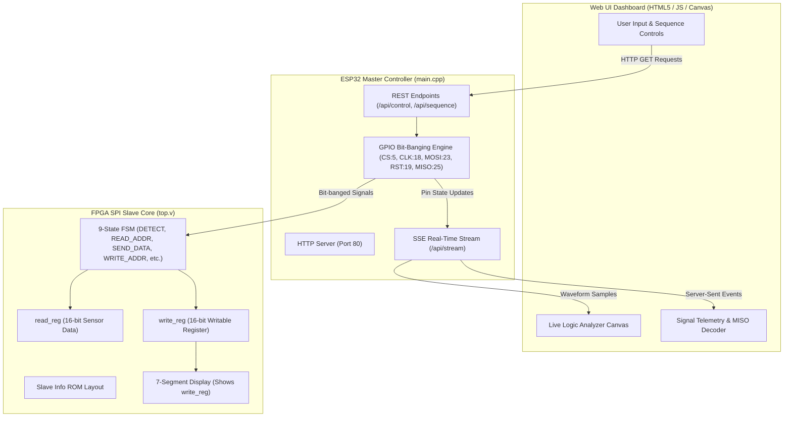

---

## 2. ESP32 Master Code Explanation (`main.cpp`)

The ESP32 firmware acts as a high-precision, web-controlled SPI Master. Key sections of `main.cpp` include:

### A. Pin Allocation & Initial State
- **MOSI (Pin 23)**: Output signal sent from ESP32 to FPGA.
- **CLK (Pin 18)**: Output clock signal generated by ESP32.
- **RST (Pin 19)**: Active-high reset output.
- **CS (Pin 5)**: Active-low Chip Select output.
- **MISO (Pin 25)**: Input signal received from FPGA.

### B. Accurate Delay Function (`smartDelayUs`)
Standard `delay()` in Arduino framework is millisecond-based and non-blocking for long periods. `smartDelayUs(us)` handles sub-millisecond bit-banging timing without triggering the ESP32 hardware watchdog timer:
```cpp
void smartDelayUs(unsigned long us) {
    if (us >= 16000) {
        delay(us / 1000);
        delayMicroseconds(us % 1000);
    } else {
        delayMicroseconds(us);
    }
}
```

### C. Sequence Bit-Banging Engine (`/api/sequence`)
When the user sends a sequence of $N$ bits via HTTP GET:
1. `CS` pin is pulled LOW (active state).
2. For each bit $i$ ($0 \le i < N$):
   - Set `MOSI` pin to bit value.
   - Wait $T/4$ microseconds (half low-cycle).
   - Pull `CLK` HIGH (rising edge).
   - Wait $T/2$ microseconds (high-cycle).
   - Pull `CLK` LOW (falling edge).
   - Read `MISO` pin on falling edge and record bit.
   - Wait $T/4$ microseconds (half low-cycle).
3. `CS` pin is pulled HIGH (idle state).
4. Returns recorded MISO bit string to Web UI in JSON format: `{"status":"ok", "miso":"1010..."}`.

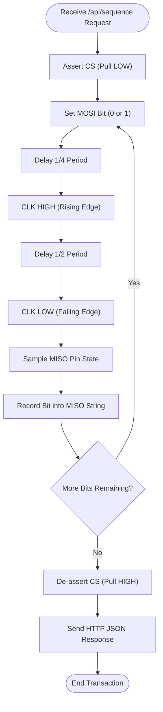

---

## 3. FPGA Verilog State Machine Explanation (`top.v`)

The Verilog top module implements a 9-state Finite State Machine operating on the falling edge of `Sclk` for driving `MiSo` and posedge of `Sclk` for state transitions.

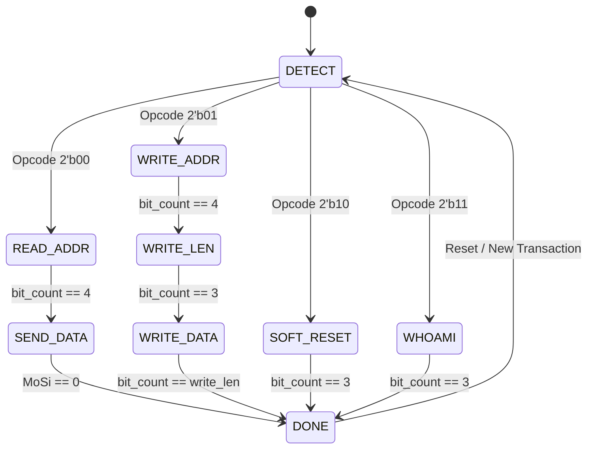

### Opcode Summary
- **`2'b00` (READ)**: Loads `read_reg <= sensor_data` and enters `READ_ADDR` state to shift 4 address bits. Then enters `SEND_DATA` state to transmit register data onto MISO.
- **`2'b01` (WRITE)**: Enters `WRITE_ADDR` (4 bits) $\rightarrow$ `WRITE_LEN` (4 bits) $\rightarrow$ `WRITE_DATA` (`write_len + 1` bits), writing incoming MOSI bits into `write_reg[write_idx]`.
- **`2'b10` (SOFT_RESET)**: Captures a 4-bit password into `pass_reg`. If `pass_reg == 4'b1010`, resets `read_reg` to `0xFFFF` and `write_reg` to `0x0000`.
- **`2'b11` (WHOAMI)**: Responds on MISO with the 4-bit slave ID `4'b0111` (`0x7`).

---

## 4. Experimental Results & Simulation Case Studies

### Case Study 1: Reading Sensor Data (`0x2800`)

- **Sensor Data Input**: `16'h2800` (binary: `0010 1000 0000 0000`).
- **Command Sequence**:
  - Opcode `00` (READ)
  - Address `1000` (16 in decimal, pointing to `read_reg`)
  - 16 clock cycles with MOSI = `0`
- **MOSI Sequence**: `00` `1000` `0000000000000000` (22 bits total)
- **Result**: MISO returns `0010100000000000` which translates to **`0x2800`** in Hexadecimal!

#### Bit-by-Bit Breakdown Table (READ 0x2800)

| Clock Cycle | MOSI Bit | FSM State | Action / Description | MISO Output |
| :--- | :--- | :--- | :--- | :--- |
| 1 | `0` | `DETECT` | `mode[1] <= 0` | `0` |
| 2 | `0` | `DETECT` | `mode[0] <= 0` $\rightarrow$ Opcode `00` (READ). Loads `read_reg <= 0x2800` | `0` |
| 3..6 | `1000` | `READ_ADDR` | Shifts address bits into `addr` register (`addr = 16`) | `0` |
| 7 | `0` | `SEND_DATA` | Clocks out Bit 15 (`0`) | `0` |
| 8 | `0` | `SEND_DATA` | Clocks out Bit 14 (`0`) | `0` |
| 9 | `0` | `SEND_DATA` | Clocks out Bit 13 (`1`) | **`1`** |
| 10 | `0` | `SEND_DATA` | Clocks out Bit 12 (`0`) | `0` |
| 11 | `0` | `SEND_DATA` | Clocks out Bit 11 (`1`) | **`1`** |
| 12 | `0` | `SEND_DATA` | Clocks out Bit 10 (`0`) | `0` |
| 13 | `0` | `SEND_DATA` | Clocks out Bit 9 (`0`) | `0` |
| 14 | `0` | `SEND_DATA` | Clocks out Bit 8 (`0`) | `0` |
| 15..22 | `0...` | `SEND_DATA` | Clocks out remaining lower bits (`0000 0000`) | `0` |

> **MISO Captured Output**: `0010 1000 0000 0000` $\rightarrow$ **`0x2800`**

---

### Case Study 2: Writing Register Data (`0x0028`)

- **Target Value**: `write_reg` = `16'h0028` (binary: `0000 0000 0010 1000`). Note that bit 3 = `1` and bit 5 = `1`.
- **Command Sequence**:
  - Opcode `01` (WRITE)
  - Address `0000` (Start at bit index 0)
  - Write Length `0101` (5 in decimal $\implies$ 6 data bits)
  - Data payload `001010` (bits 0,1,2,3,4,5 written as LSB-first: bit 3=1, bit 5=1)
- **MOSI Sequence**: `01` `0000` `0101` `001010` (16 bits total)
- **Result**: `write_reg` is updated from `0x0000` to **`0x0028`**!

#### Bit-by-Bit Breakdown Table (WRITE 0x0028)

| Clock Cycle | MOSI Bit | FSM State | Action / Description | `write_reg` State |
| :--- | :--- | :--- | :--- | :--- |
| 1 | `0` | `DETECT` | `mode[1] <= 0` | `0x0000` |
| 2 | `1` | `DETECT` | `mode[0] <= 1` $\rightarrow$ Opcode `01` (WRITE) | `0x0000` |
| 3..6 | `0000` | `WRITE_ADDR` | Sets address `addr = 0` | `0x0000` |
| 7..10 | `0101` | `WRITE_LEN` | Sets `write_len = 5` (6 data bits) | `0x0000` |
| 11 | `0` | `WRITE_DATA` | Writes bit 0 $\rightarrow$ `write_reg[0] = 0` | `0x0000` |
| 12 | `0` | `WRITE_DATA` | Writes bit 1 $\rightarrow$ `write_reg[1] = 0` | `0x0000` |
| 13 | `1` | `WRITE_DATA` | Writes bit 2 $\rightarrow$ `write_reg[2] = 0` | `0x0000` |
| 14 | `0` | `WRITE_DATA` | Writes bit 3 $\rightarrow$ `write_reg[3] = 1` | `0x0008` |
| 15 | `1` | `WRITE_DATA` | Writes bit 4 $\rightarrow$ `write_reg[4] = 0` | `0x0008` |
| 16 | `0` | `WRITE_DATA` | Writes bit 5 $\rightarrow$ `write_reg[5] = 1` | **`0x0028`** |

---

### Case Study 3: The `01010101...` Alternating Bit Phenomenon (`0xA000`)

When an alternating stream of `01010101...` was sent to the SPI MOSI line, the FPGA's 7-segment display changed from `0000` to `A000`. Here is the exact mathematical reason why:

1. **Opcode Decoding**: The first 2 bits sent are `0` and `1`. This decodes to opcode `2'b01` (WRITE state).
2. **Address Decoding**: The next 4 bits sent are `0`, `1`, `0`, `1`. This decodes to address **`4'd5`** (Address 5).
3. **ROM Lookup**: At `addr = 5`, the ROM maps bit offsets starting at `in_start = 12` with length `4`.
4. **Data Writing**: The next 4 bits sent are `0`, `1`, `0`, `1`. These are written to bits 12, 13, 14, 15 of `write_reg`:
   - Bit 12 = `0`
   - Bit 13 = `1`
   - Bit 14 = `0`
   - Bit 15 = `1`
5. **Final Register Value**: Bits `[15:12]` become binary `1010` (which is `A` in Hex). Bits `[11:0]` remain `0000`. Thus, `write_reg` becomes **`16'hA000`**!

---

## 5. Complete Physical & Simulation Image Gallery

### Physical Setup & Logic Analyzer Oscilloscope Captures

#### Physical Test Bench Setup
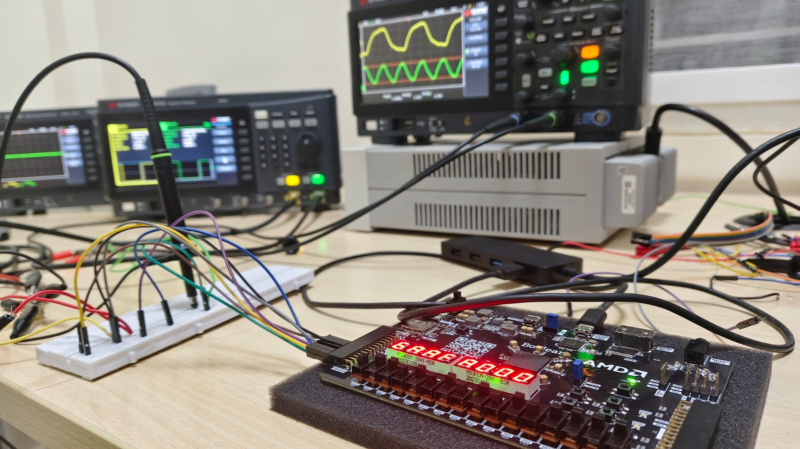
*Figure 1: FPGA test board connected to logic analyzer channels and 7-segment display.*

---

#### WHO_AM_I Transaction at 10MHz Clock
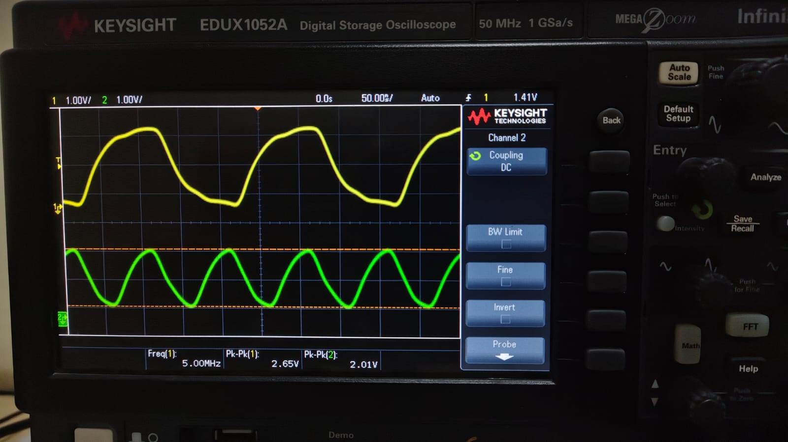
*Figure 2: Logic analyzer capture showing WHO_AM_I transaction running at 10MHz clock speed.*

---

#### WHO_AM_I Transaction at 50kHz Clock
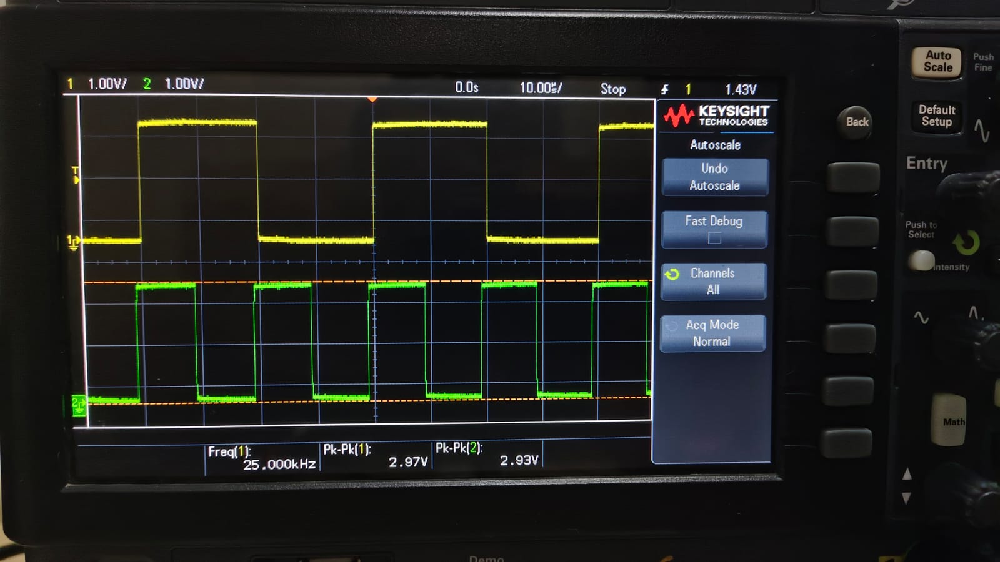
*Figure 3: Logic analyzer capture showing WHO_AM_I transaction running at 50kHz clock speed.*

---

#### Sensor Read Transaction Capture at 50kHz
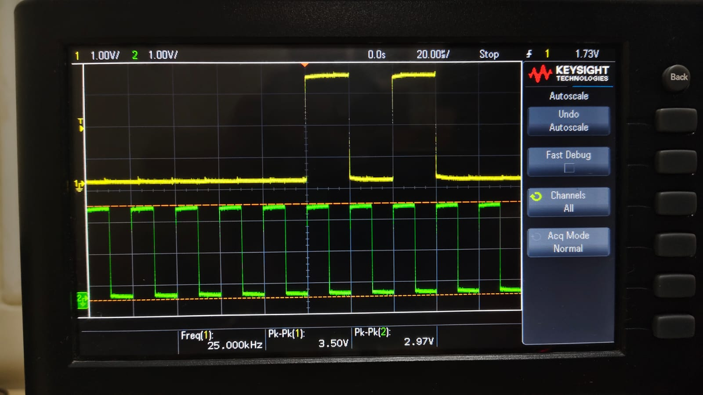
*Figure 4: Scope capture showing sensor read transaction returning data from FPGA SPI slave.*

---

#### FPGA 7-Segment Display: Initial vs Final State (`0000` to `A000`)

| Initial Register State (`0000`) | Final Register State (`A000`) |
| :---: | :---: |
| 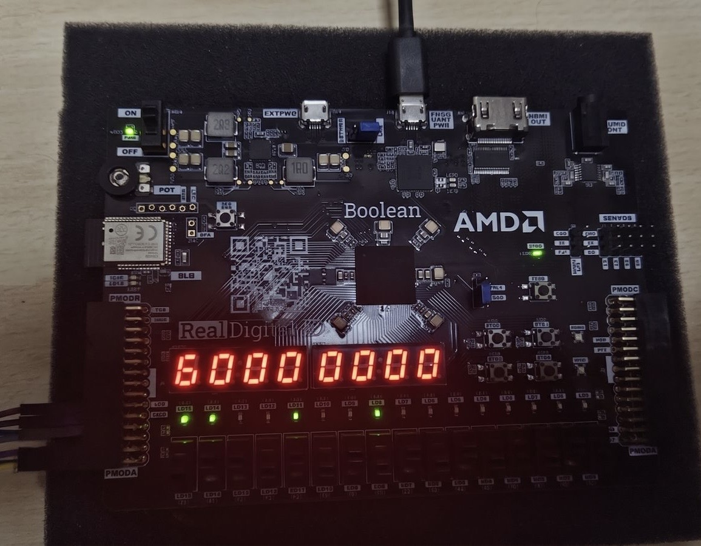 | 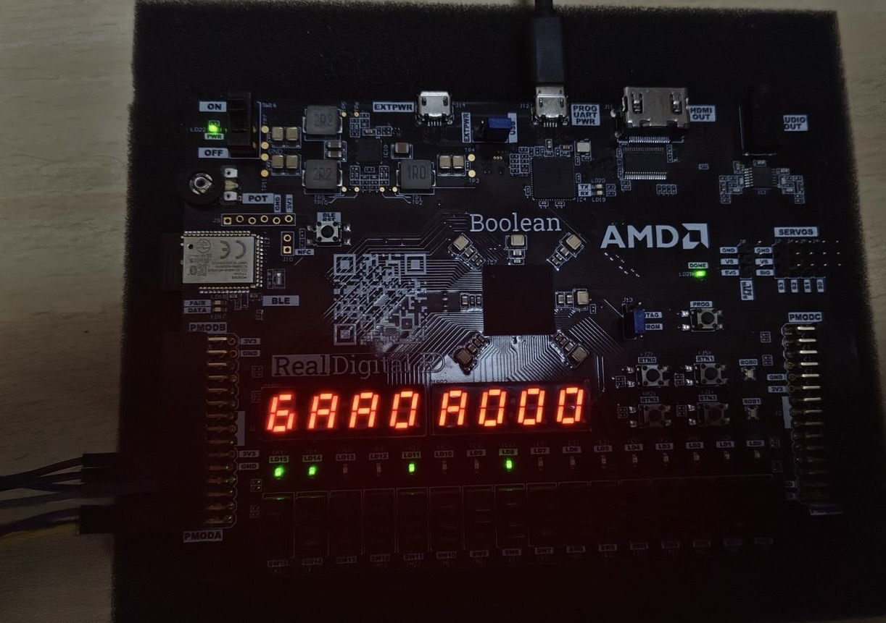 |
| *Figure 5: 7-Segment displaying `0000` before test.* | *Figure 6: 7-Segment displaying `A000` after test.* |

---

#### Detailed Oscilloscope Protocol Waves (MOSI & MISO)

| MOSI Read Command | MISO Read Response |
| :---: | :---: |
| 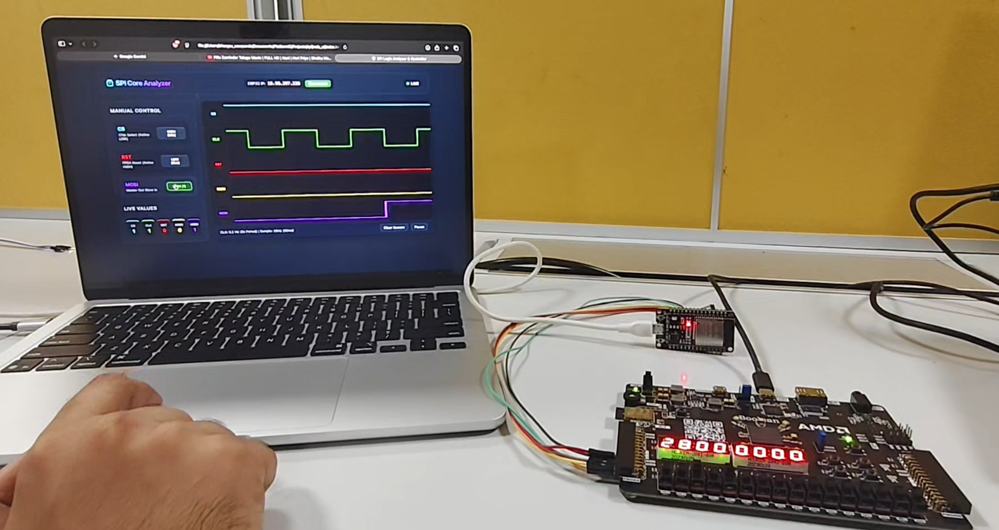 | 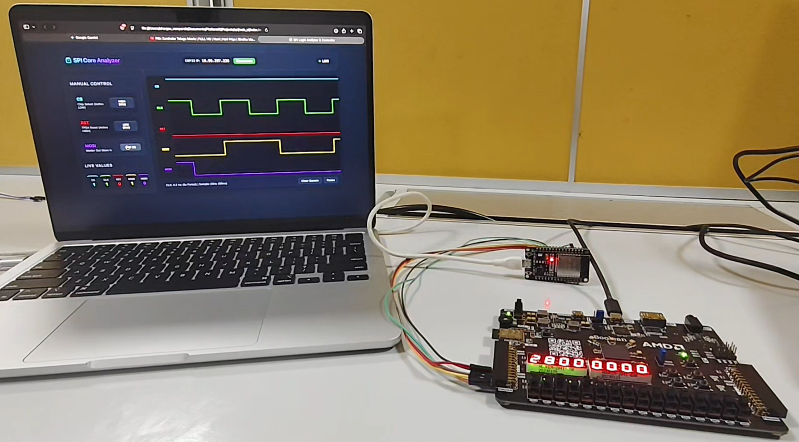 |
| *Figure 7: Logic analyzer MOSI command line.* | *Figure 8: Logic analyzer MISO data return line.* |

| Write Transaction Capture (Part 1) | Write Transaction Capture (Part 2) |
| :---: | :---: |
| 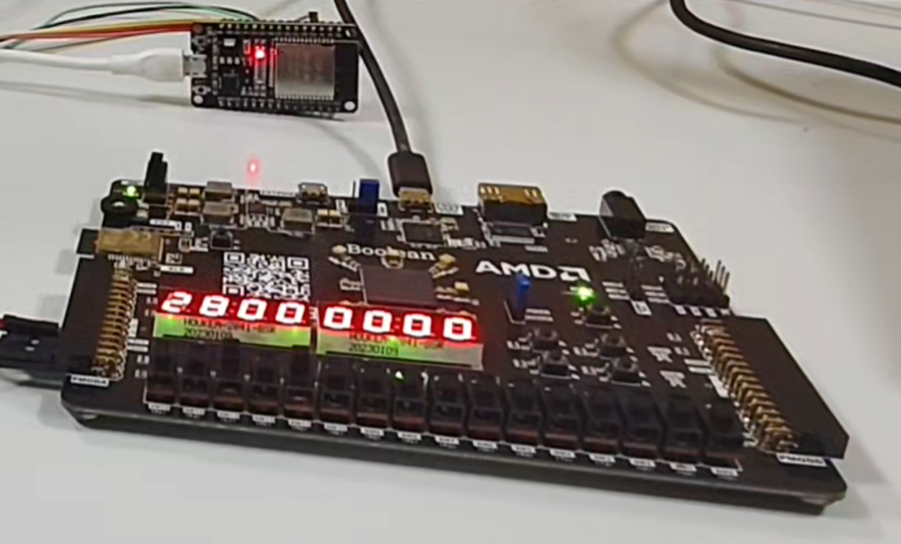 | 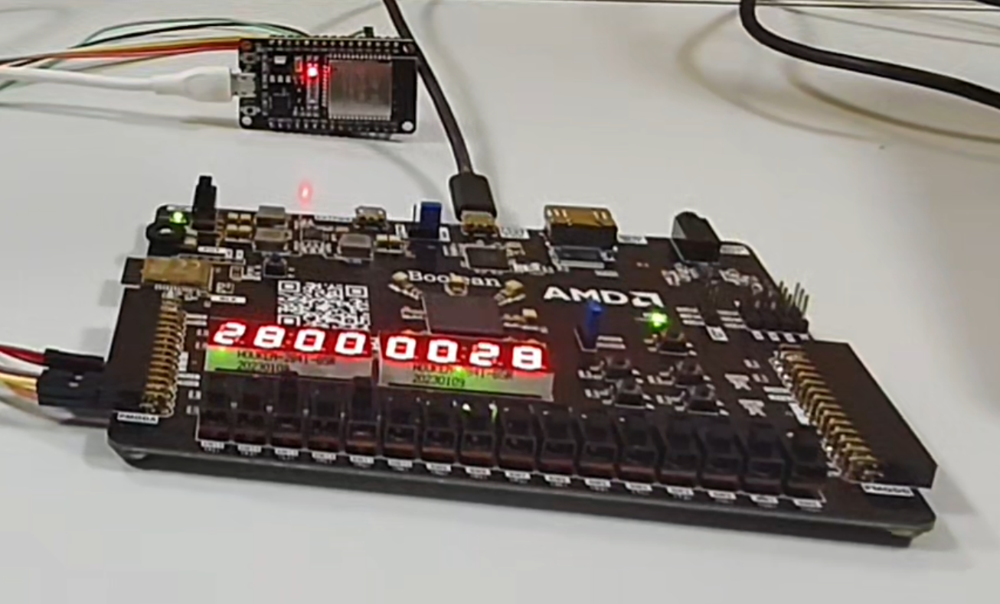 |
| *Figure 9: Write transaction signal waveforms.* | *Figure 10: Write transaction data completion.* |

---

### Web Simulator Screenshots (Matching `top.v` Verilog FSM)

#### Dashboard Overview
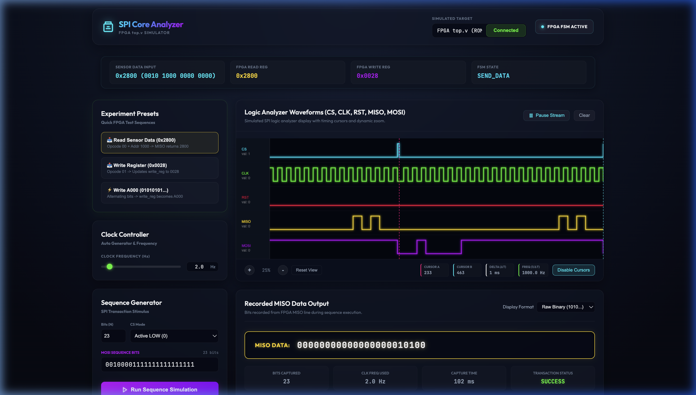
*Figure 11: Web UI simulation dashboard showing FPGA registers, presets, and Canvas logic analyzer waveforms.*

---

#### Case 1 Simulation: Reading Sensor Data (`0x2800`)

*Figure 12: Web UI simulation executing READ sequence for `sensor_data = 0x2800`. MISO banner records `0010100000000000` (`0x2800`).*

---

#### Case 2 Simulation: Writing Register (`0x0028`)
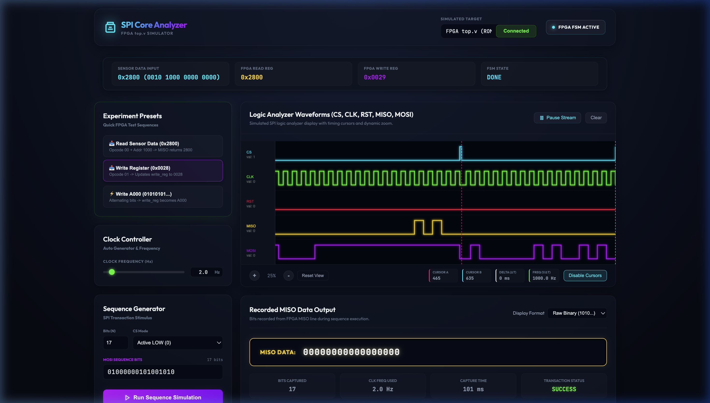
*Figure 13: Web UI simulation executing WRITE sequence updating `write_reg` to `0x0028` (`0000 0000 0010 1000`).*

---

#### Case 3 Simulation: Alternating Bit Sequence (`0xA000`)
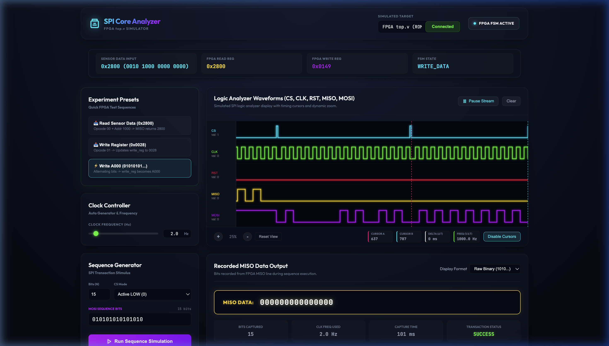
*Figure 14: Web UI simulation executing alternating `01010101...` sequence updating `write_reg` to `0xA000`.*

---

## 6. Summary & File Locations

All experiment files, simulation code, images, and Verilog source files are organized within `report/esp_exp_data/`:

- **Report Document**: [esp_experiment_report.md](esp_experiment_report.md)
- **Directory Readme**: [README.md](README.md)
- **Simulation Web UI**: [index.html](sim_web_ui/index.html)
- **ESP32 Firmware**: [main.cpp](src/main.cpp)
- **FPGA Verilog Module**: [top.v](verilog/top.v)
- **Image Directory**: [images/](../images/)
