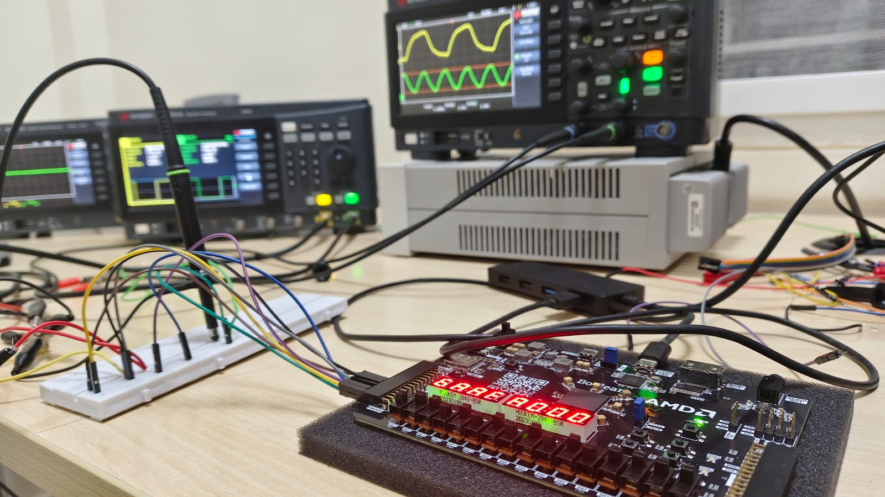
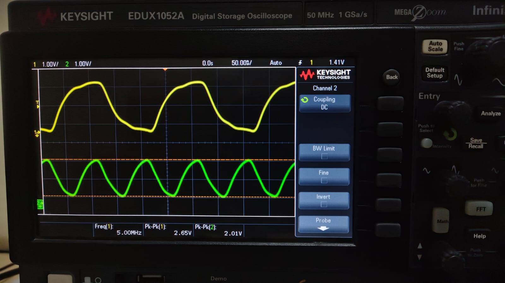
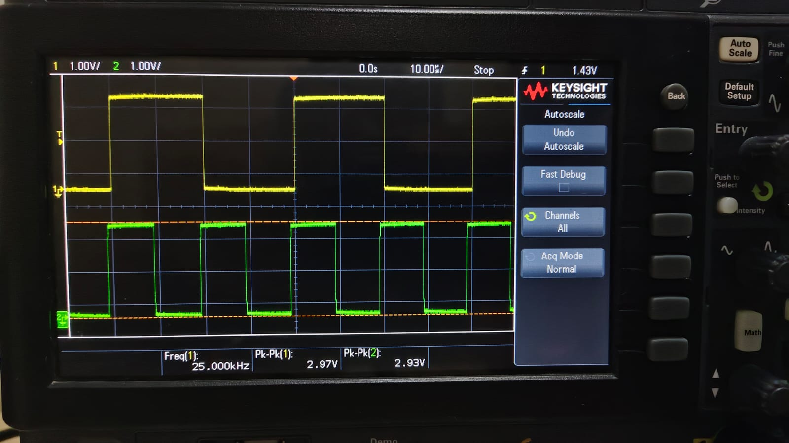
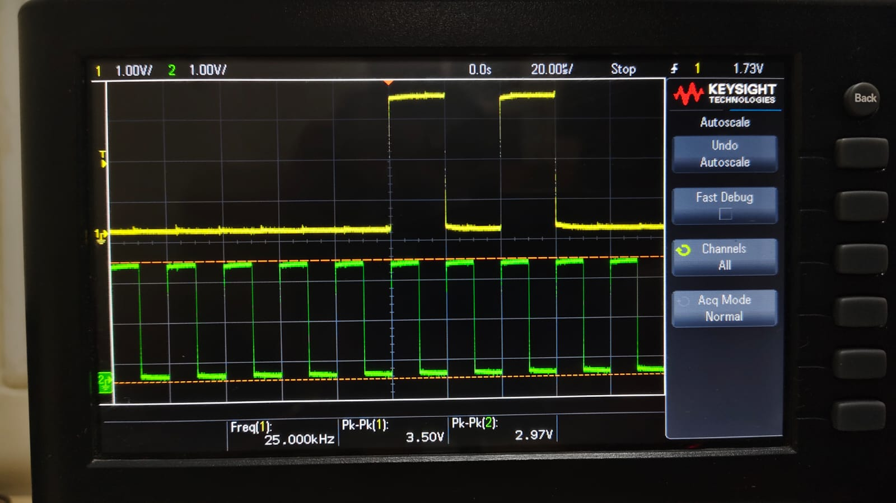
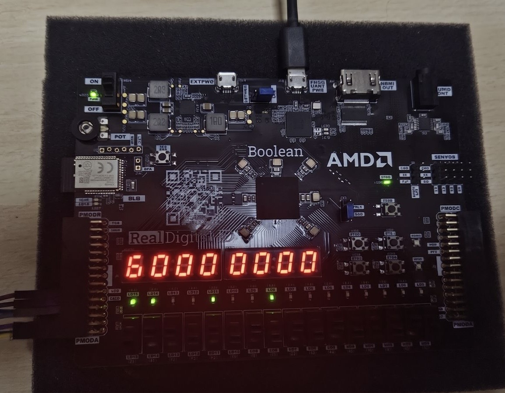
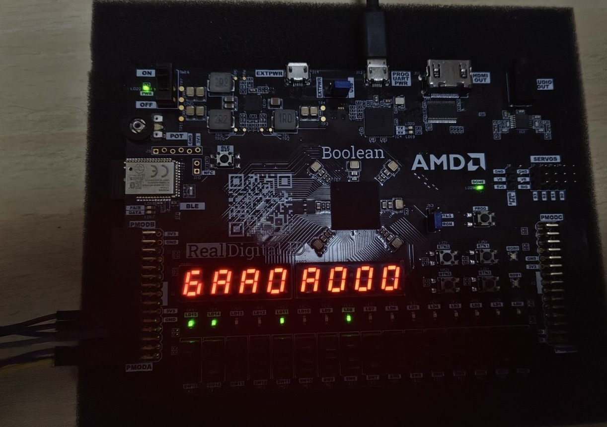

# SPI ROM Testing and Image Descriptions

## Overview
This document contains descriptions of the test images for the SPI ROM project and provides a detailed technical breakdown of how a simple alternating bit pattern (`0101010101...`) resulted in the `write_reg` displaying `A000` on the FPGA's 7-segment display.

## Test Setup and Environment
- 
  *Description: The physical setup of the FPGA being used to test the SPI ROM module.*

## WHO_AM_I State Tests
- 
  *Description: Logic analyzer or oscilloscope capture showing the `WHO_AM_I` transaction operating successfully at a 10MHz clock.*
- 
  *Description: Logic analyzer capture of the `WHO_AM_I` transaction running at a slower 50kHz clock.*

## Reading Sensor Data
- 
  *Description: Logic analyzer capture showing a read transaction for one of the sensors at 50kHz.*

## The Write Transaction Phenomenon: `0000` to `A000`
We observed that by simply sending an alternating sequence of `0101010101...` to the SPI MOSI line, the 5th sensor's input data was altered, and the overall 16-bit register changed from `0000` to `A000`.

Here are the before and after images of the 7-segment display:
- 
- 

### Detailed Breakdown of the `0101010101...` Transaction

When the SPI master sends a continuous stream of `0101010101...` on the `MOSI` line while `CS` is active, the SPI Slave FSM processes this as a completely valid **Write Transaction** targeting the 5th sensor (mapped to address `4'd5`).

Here is the exact bit-by-bit breakdown of how this happens:

#### 1. Command Decoding (`DETECT` State)
The FSM begins in the `DETECT` state, waiting for a 2-bit opcode.
- **Bit 1**: `0` -> captured into `mode[1]`
- **Bit 2**: `1` -> captured into `mode[0]`
- **Result**: The opcode is `2'b01`. According to the FSM logic, `2'b01` corresponds to the `WRITE_ADDR` state.

#### 2. Address Decoding (`WRITE_ADDR` State)
The FSM transitions to `WRITE_ADDR` and expects exactly 4 bits for the memory address. It shifts the incoming bits into the `addr` register.
- **Bit 3**: `0` -> `addr` becomes `4'b0000`
- **Bit 4**: `1` -> `addr` becomes `4'b0001`
- **Bit 5**: `0` -> `addr` becomes `4'b0010`
- **Bit 6**: `1` -> `addr` becomes `4'b0101`
- **Result**: The final 4-bit address is **`4'd5`** (`0101` in binary).

#### 3. ROM Lookup
With `addr = 4'd5`, the `slave_info_rom` instantly provides the layout configuration for this specific address. According to the ROM logic in `top.v`:
```verilog
// Sensor 4: 4 bits (Bits 12-15)
4'd5: begin
    in_width  = 4'd4;
    in_start  = 4'd12;
end
```
This configuration tells the FSM to expect **4 bits** of data, and to place those bits starting at **index 12** of the `write_reg`.

#### 4. Data Writing (`WRITE_DATA` State)
The FSM now transitions to `WRITE_DATA` and shifts the next 4 bits into `write_reg`, calculating the target index as `(rom_in_start + bit_count)`.
- **Bit 7**: `0` -> written to `write_reg[12 + 0]` (bit 12)
- **Bit 8**: `1` -> written to `write_reg[12 + 1]` (bit 13)
- **Bit 9**: `0` -> written to `write_reg[12 + 2]` (bit 14)
- **Bit 10**: `1` -> written to `write_reg[12 + 3]` (bit 15)
- **Result**: The top nibble (bits `[15:12]`) of `write_reg` is set to `4'b1010`.

#### 5. Final Result
Assuming the 16-bit `write_reg` was initially `16'h0000`, altering the top 4 bits (bits 15 to 12) to `4'b1010` (which translates to `A` in hexadecimal) modifies the entire register to:

`16'b1010_0000_0000_0000` -> **`16'hA000`**

This perfectly explains the phenomenon: the simple repeating sequence `0101010101...` aligned flawlessly with the SPI protocol—providing the `WRITE` opcode (`01`), addressing the 5th sensor (`0101` = 5), and sending exactly the right data payload (`0101` = `A` when placed in bits `[15:12]`) to turn the register into `A000`!
